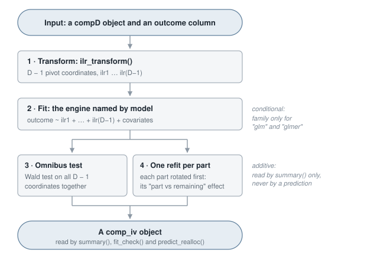

```{r setup, include = FALSE}
# R prints a note when two loaded packages register the same S3 method, as
# packages loaded with robCompositions do. The note is switched off here.
Sys.setenv("_R_S3_METHOD_REGISTRATION_NOTE_OVERWRITES_" = "false")
knitr::opts_chunk$set(
  collapse = TRUE,
  comment = "#>",
  fig.width = 7,
  fig.height = 5,
  out.width = "100%"
)
```

Once a time-use composition is declared, `comp_iv()` models a health outcome as
a function of that composition, handling the pivot isometric log-ratio (ILR)
transformation, model fitting, and basis rotations in one call. It supports
eleven model engines across continuous, binary, count, survival, ordinal, and
multinomial outcomes:

| Outcome type | Single-level model | Multilevel counterpart | Purpose and effect reported |
|---|---|---|---|
| Continuous | `"lm"` | `"lmer"` | mean difference in the outcome |
| Continuous, outlier-robust | `"lmrob"` | `"rlmer"` | mean difference, down-weighting outlying observations |
| Binary, count or rate (a GLM family) | `"glm"` | `"glmer"` | odds ratio (logit link); rate, risk or mean ratio (log link) |
| Time to event | `"cox"` | `"coxme"` | hazard ratio; relative reallocations only |
| Ordinal | `"clm"` | `"clmm"` | cumulative odds ratio; relative only |
| Unordered categories | `"mblogit"` | `"mblogit"` with `random` | one relative-risk ratio per category; relative only |

Here we focus on the two single-level engines `"lm"` and `"glm"` using the
bundled `timeuse` data (`zbmi`, `obesity`, and `sex`); for the remaining
engines and the `ilr()` formula interface, see
`vignette("advanced-models", package = "timecoda")`.

```{r load, message = FALSE}
library(timecoda)
```

```{r declare}
cd <- declare_composition(
  data    = timeuse,
  parts   = c("MVPA", "LPA", "SB", "SPT"),
  closure = 1440,
  labels  = c(
    MVPA = "Moderate-to-vigorous PA",
    LPA  = "Light PA",
    SB   = "Sedentary behaviour",
    SPT  = "Sleep"
  )
)
```

## Fitting a model

To model a continuous outcome like `zbmi`, pass the declared composition, the
outcome name, and `model = "lm"` to `comp_iv()`:

```{r fit-bmi}
fit_bmi <- comp_iv(comp = cd, outcome = "zbmi", model = "lm")
summary(object = fit_bmi)
```

Two things happen behind the scenes here. First, `comp_iv()` transforms the
four parts into $D - 1 = 3$ pivot ILR coordinates and fits the linear model,
running a joint Wald test across all three coordinates. That omnibus test is
invariant to part order and tests whether the composition as a whole is
associated with `zbmi`. (For linear models, the Wald statistic equals $(D - 1)$
times the $F$ statistic, so in small samples its p-value is slightly smaller
than that of an exact $F$ test.)

Second, because only the first pivot coordinate isolates a single behaviour
against the geometric mean of the rest (Dumuid et al., 2018; Dumuid et al.,
2020), `comp_iv()` refits the same model $D$ times—rotating each part into the
first position—and pulls out that first slope for each row of the summary
table. Each refit is just a rotation of the same model and produces identical
fitted values.

```{r pipeline, echo = FALSE, out.width = "82%", fig.alt = "Flowchart of the comp_iv() pipeline: a compD object and an outcome column enter; the composition is transformed to D minus 1 pivot ILR coordinates; the outcome is fitted on those coordinates and any covariates with the model engine named by model, with a family supplied for glm and glmer only; an omnibus Wald test on all coordinates together and one rotated refit per part, giving its part-versus-remaining effect and read by summary() only, follow side by side; the result is a comp_iv object read by summary(), fit_check() and the reallocation functions."}

```

In the table above, a one-unit increase in the pivot coordinate for `MVPA` is
associated with a 0.708-unit lower mean `zbmi`. Keep in mind that a one-unit
shift in a pivot coordinate is large: for a four-part composition, it
multiplies the ratio of that part to the geometric mean of the other three by
$\exp(\sqrt{4/3}) \approx 3.17$. That is why these slopes are best read for
direction and relative strength, while minute-based effect sizes come from
`predict_realloc()` (see
`vignette("predicting-reallocations", package = "timecoda")`). Note also that
per-part p-values are unadjusted for multiple comparisons.

## Binary outcomes and covariates

For a binary outcome like `obesity`, switch to `model = "glm"` with
`family = "binomial"`, and pass adjustment variables to `covariates`:

```{r fit-ob}
fit_ob <- comp_iv(
  comp       = cd,
  outcome    = "obesity",
  model      = "glm",
  family     = "binomial",
  covariates = "sex"
)
```

```{r summary-ob}
summary(object = fit_ob)
```

Because this is a logistic model, the pivot coefficients are automatically
exponentiated to odds ratios (similarly, `"log"` links report rate, risk, or
mean ratios, and `"identity"` links report mean differences). You can pass
`family` either as a string (`"binomial"`) or a family object
(`binomial(link = "logit")`). Here, spending more time in `MVPA` relative to the
rest of the day is associated with lower odds of obesity (OR = 0.501, 95% CI
[0.382, 0.656]), adjusted for sex. The `Convergence: OK` line confirms the
backend fitted without warnings; if any warnings occur, they appear there.

Variables passed to `covariates` enter as main effects. Comparing `fit_ob` with
an unadjusted fit shows that sex barely shifts the compositional estimates in
these data:

```{r fit-ob-unadj}
fit_ob_unadj <- comp_iv(comp = cd, outcome = "obesity", model = "glm",
                        family = "binomial")
summary(object = fit_ob_unadj)
```

If you need composition-by-covariate interactions, see the moderation section
in `vignette("advanced-models", package = "timecoda")`. For compositions whose
row totals vary across participants (such as waking wear time), you can also
include the total itself via `include_total = TRUE`.

Two minor options are worth keeping in mind: you can change confidence interval
coverage without refitting via `summary(object = fit_ob, conf_level = 0.90)`,
and you can forward extra backend arguments (like observation weights or
optimizer controls) through `model_args` (see `?comp_iv`).

```{r summary-90}
summary(object = fit_ob, conf_level = 0.90)
```

## Checking the fit

Before plotting or reporting predictions, we check model assumptions with
`fit_check()`. For `"lm"`, `"glm"`, `"lmer"`, and `"glmer"` fits, it computes
simulated quantile residuals via `DHARMa` (Dunn & Smyth, 1996; Hartig, 2026)
under a fixed internal seed (override with `seed` if needed):

```{r check-ob, eval = requireNamespace("DHARMa", quietly = TRUE), fig.width = 9, fig.height = 5, fig.alt = "DHARMa diagnostic panels for the logistic fit: a QQ plot of the simulated quantile residuals against the uniform distribution, with the points along the diagonal and the three test results printed on it, and the residuals plotted against the rank-transformed model predictions, with quantile curves close to dashed lines at 0.25, 0.5 and 0.75."}
fit_check(object = fit_ob)
```

None of the three checks suggests misspecification for `fit_ob`.

Running the same diagnostic on `fit_bmi` flags a single observation outside the
simulated range (marked by a star in the right panel), which is consistent with
random variation ($p = 0.738$). At the console, `DHARMa` may also emit an
`mgcv` warning when estimating the visual quantile curves; this affects only
the plotted curves and not the three test statistics.

```{r check-bmi, eval = requireNamespace("DHARMa", quietly = TRUE), warning = FALSE, fig.width = 9, fig.height = 5, fig.alt = "DHARMa diagnostic panels for the linear fit: a QQ plot of the simulated quantile residuals against the uniform distribution, with the points along the diagonal, and the residuals plotted against the rank-transformed model predictions, with quantile curves close to dashed lines at 0.25, 0.5 and 0.75 and one outlying observation marked by a star at the bottom edge."}
fit_check(object = fit_bmi)
```

## Visualizing the fitted surface

To see how predicted obesity risk varies across the simplex, we plot the fitted
surface. For a four-part composition, `plot()` draws one ternary panel per
three-part subcomposition—holding the fourth part at the sample's closed
geometric mean (marked by the black point)—with each grid cell shown as an
uninterpolated hexagonal tile coloured by its odds ratio relative to that
reference day:

```{r plot-ob, fig.width = 7, fig.height = 5, fig.alt = "One of four ternary panels, one for each group of three parts, of the logistic fit's odds-ratio surface as tiles. In each, several dozen small hexagonal tiles form a patch inside the triangle, coloured from dark purple for the panel's lowest odds ratio to yellow for its highest, with a black point at the reference composition; the rest of the triangle is blank grey."}
p_ob <- plot(x = fit_ob)
```

```{r plot-ob-values, include = FALSE}
mvpa_panels <- grep("MVPA", names(p_ob), value = TRUE)
mvpa_low <- min(purrr::map_dbl(p_ob[mvpa_panels], function(p) min(p$data$.pred)))
```

To avoid extrapolating into empty corners of the simplex, predictions are
masked by default to the region where each part falls between its 5th and 95th
observed percentiles (pass `quantiles = NULL` to colour the entire triangle).
In the three panels containing `MVPA`, predicted odds ratios drop as low as
`r round(mvpa_low, 2)` toward the high-`MVPA` edge of the observed band.

For a continuous colour gradient instead of discrete hexagonal tiles, pass
`smooth = TRUE`, which fits a quadratic surface on the link scale over a finer
lattice using the same underlying grid values:

```{r plot-ob-smooth, fig.width = 7, fig.height = 5, fig.alt = "One of four ternary panels, one for each group of three parts, of the logistic fit's smoothed odds-ratio surface. In each, a continuous patch of colour inside the triangle runs from dark purple for the panel's lowest odds ratio to yellow for its highest, with a black point at the reference composition; the rest of the triangle is blank grey."}
plot(x = fit_ob, smooth = TRUE)
```

## Publication tables

To turn the full-precision `summary()` output into a formatted `gt` table for a
manuscript, pass it to `pub_ready()`:

```{r pub-ready, eval = requireNamespace("gt", quietly = TRUE)}
pub_ready(x = summary(object = fit_ob))$effects
```

Estimates and confidence bounds default to two decimal places (`digits = 2`),
with p-values below 0.001 displayed as `<0.001`. Printing
`pub_ready(x = summary(object = fit_ob))` without `$effects` displays all
tables built for that summary.

## References

Dumuid, D., Stanford, T. E., Martín-Fernández, J. A., Pedišić, Ž., Maher,
C. A., Lewis, L. K., Hron, K., Katzmarzyk, P. T., Chaput, J. P., Fogelholm,
M., Hu, G., Lambert, E. V., Maia, J., Sarmiento, O. L., Standage, M.,
Barreira, T. V., Broyles, S. T., Tudor-Locke, C., Tremblay, M. S., & Olds, T.
(2018). Compositional data analysis for physical activity, sedentary time and
sleep research. *Statistical Methods in Medical Research*, 27, 3726-3738.

Dumuid, D., Pedišić, Ž., Palarea-Albaladejo, J., Martín-Fernández, J. A.,
Hron, K., & Olds, T. (2020). Compositional data analysis in time-use
epidemiology: What, why, how. *International Journal of Environmental Research
and Public Health*, 17, 2220.

Dunn, P. K., & Smyth, G. K. (1996). Randomized quantile residuals. *Journal of
Computational and Graphical Statistics*, 5, 236-244.

Hartig, F. (2026). *DHARMa: Residual diagnostics for hierarchical (multi-level
/ mixed) regression models*. R package version 0.5.0.

## See also

- `vignette("composition-variable", package = "timecoda")`: declaring and
  describing the composition that `comp_iv()` takes as input.
- `vignette("predicting-reallocations", package = "timecoda")`: estimating the
  change in the outcome when time moves between two parts, from a
  `comp_iv()` fit.
- `vignette("advanced-models", package = "timecoda")`: the other model engines,
  the formula interface, moderation, and the total as a covariate.
- `vignette("timecoda", package = "timecoda")`: the whole workflow in one
  analysis.
