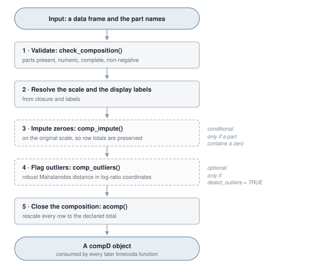

```{r setup, include = FALSE}
# R prints a note when two loaded packages register the same S3 method, as
# packages loaded with robCompositions do. The note is switched off here.
Sys.setenv("_R_S3_METHOD_REGISTRATION_NOTE_OVERWRITES_" = "false")
knitr::opts_chunk$set(
  collapse = TRUE,
  comment = "#>",
  fig.width = 7,
  fig.height = 5,
  out.width = "100%"
)
```

```{r load, message = FALSE}
library(timecoda)
```

# Compositional data

Given that the parts of a composition sum to a constant, a minute added to one
behaviour is taken from another, and a group that spends more time in one part
spends less in at least one other (Dumuid et al., 2020; Pedišić et al., 2017).
Separate comparisons of each part therefore test quantities that cannot vary
independently, and statistics computed directly on the parts are distorted by
the constraint.

Compositional analysis instead works on the log-ratios between parts, which are
unconstrained and carry the relative information in a composition (Aitchison,
1986; Dumuid et al., 2020). Isometric log-ratio (ILR) coordinates express a
`D`-part composition as `D - 1` unconstrained real numbers that retain all of
its relative information (Egozcue et al., 2003). Pivot coordinates, a family of
ILR coordinates, contrast the first part with the geometric mean of all the
others in the first coordinate (Filzmoser et al., 2018).

In `timecoda`, a composition is represented by a `compD` object built with
`declare_composition()`. You declare the part names, the reporting scale and the
treatment of zeroes there once, and every later function in the package takes
that object in place of the raw columns.

The examples use the bundled `timeuse` data, a simulated sample of 300
participants whose days are divided into four parts, namely moderate-to-vigorous
physical activity (`MVPA`), light physical activity (`LPA`), sedentary behaviour
(`SB`) and sleep (`SPT`, the sleep period time).

# Part 1. The declare pipeline

## What `declare_composition()` does

A single call to `declare_composition()` runs five steps, two of them
conditional, and three of the steps are also exported as functions you can run
on their own.

```{r pipeline, echo = FALSE, out.width = "82%", fig.alt = "Flowchart of the declare_composition() pipeline: validate the parts, resolve the scale and labels, impute zeroes when present, flag outliers when requested, close the composition, and return a compD object."}

```

## A complete declaration

To make the results reproducible, set a seed first, because outlier detection
draws a random subset.

```{r declare}
set.seed(1)

cd <- declare_composition(
  data            = timeuse,
  parts           = c("MVPA", "LPA", "SB", "SPT"),
  closure         = 1440,
  labels          = c(
    MVPA = "Moderate-to-vigorous PA",
    LPA  = "Light PA",
    SB   = "Sedentary behaviour",
    SPT  = "Sleep"
  ),
  impute_method   = "lrEM",
  detect_outliers = TRUE,
  outlier_args    = list(quantile = 0.975)
)
```

## Reading the summary

```{r summary}
summary(object = cd)
```

The row totals in the header are taken before closure, and totals that differ
appreciably from the declared closure show that the data were rescaled by that
amount.

With outlier flagging, the summary also reports the number of observations
flagged and the cutoff they exceeded, the square root of the 97.5th percentile
of a chi-squared distribution on `D - 1` degrees of freedom. The probability
printed beside the cutoff is the `quantile` you declared.

The geometric mean is computed from the imputed, closed composition, whereas the
other columns describe each part as recorded, with zeroes included and before
closure.

The variation matrix holds `var(log(x_i / x_j))` for every pair of parts and is
the compositional counterpart of a correlation matrix (Dumuid et al., 2020;
Pedišić et al., 2017). A small entry marks two parts that vary proportionally
to one another, and a large entry two parts that vary largely independently.
Sedentary behaviour and sleep have the smallest entry, so their ratio is the
most stable across the sample.

# Part 2. The steps in detail

## Validation

`check_composition()` is run before anything else, and the call stops with a
message naming the part at fault when a part is absent from the data,
non-numeric, incomplete or negative. Zeroes are allowed here because the next
step imputes them.

To screen data before you declare a composition, call the exported function on
its own. To check that every row sums to the expected value within a tolerance,
set `total`. This check detects accelerometer or diary records that do not
account for a full day.

## The reporting scale

To fix the scale on which the composition is reported, set `closure`. It
accepts a positive number or one of two strings, and its value is stored on the
object and shared by every downstream summary, plot and prediction.

| Value | Result |
|---|---|
| `1440` | minutes per day |
| `1` (default) | proportions |
| `100` or `"percent"` | percentages |
| `"mean"` | the average of the observed row totals |

Use `"mean"` for records that vary in duration and have no nominal total,
because it reports the composition on the scale observed in the data. For
records whose totals vary between people, see the section on the total as a
covariate in `vignette("advanced-models", package = "timecoda")`.

## Zero imputation

A zero in a compositional part usually reflects a value below the resolution of
the measurement, and `comp_impute()` replaces zeroes with small positive values
using the imputation methods of the `zCompositions` package (Palarea-Albaladejo
& Martín-Fernández, 2015).

`timeuse` contains no zeroes, so five values of `MVPA` are set to zero in the
example.

```{r impute}
z <- timeuse
z$MVPA[1:5] <- 0

set.seed(1)
cd_z <- declare_composition(data = z, parts = c("MVPA", "LPA", "SB", "SPT"),
                            closure = 1440, impute_method = "multRepl")

summary(object = cd_z, var_matrix = FALSE)
```

By default, the detection limit of a part is the smallest positive value
observed for it, and each imputed value lies below that limit. To use a limit
defined by the measuring instrument, supply it directly through `dl`.

To choose the imputation method, set `impute_method` to one of the five methods
below.

| Method | Approach |
|---|---|
| `"lrEM"` (default) | log-ratio expectation-maximization |
| `"multRepl"` | multiplicative replacement |
| `"lrDA"` | log-ratio data augmentation |
| `"multLN"` | multiplicative lognormal |
| `"lrSVD"` | singular value decomposition |

`"lrEM"` is the default because it estimates replacement values from the
covariance structure of the remaining parts, while `"multRepl"` is the simplest
method and is adequate when zeroes are few. To pass controls specific to a
method, use `...`.

Imputation is run on the original scale, before closure, so each row's absolute
total is preserved for the models that use it.

## Outlier flagging

A compositional outlier is an observation with atypical ratios between parts,
and such observations cannot be seen when the parts are examined one at a time.
A participant reporting fourteen hours of sleep and no moderate-to-vigorous
activity, for example, may fall within the observed range of every individual
part and still lie far from the centre of the simplex. Every model in this
package is fitted on log-ratio coordinates, so an observation of this kind
exerts leverage on every estimate derived from the composition.

`comp_outliers()` implements the method of Filzmoser and Hron (2008), in which
the robust Mahalanobis distance of each observation from the centre is computed
in pivot log-ratio coordinates with the minimum covariance determinant estimator
and then compared against a chi-squared cutoff.

The distance is invariant to the closure of the composition and to the choice of
log-ratio pivot, so the flags are the same whatever scale the parts are reported
on and whatever order they are listed in.

If you set `quantile` above the default `0.975`, the cutoff widens and fewer
observations are flagged.

```{r outliers-quantile}
set.seed(1)
cd_strict <- declare_composition(data = timeuse,
                                 parts = c("MVPA", "LPA", "SB", "SPT"),
                                 closure = 1440, detect_outliers = TRUE,
                                 outlier_args = list(quantile = 0.99))

summary(object = cd_strict, desc = FALSE, var_matrix = FALSE)
```

Flagged observations are never removed, and every element of the object keeps
one entry per input observation.

# Part 3. Describing a declared composition

## Publication tables

The descriptive tables returned by `summary()` have full numeric precision for
further computation. To round them for publication, use `pub_ready()`, which
builds the table with the `gt` package, a suggested package that no other
function requires.

```{r pub-ready, eval = requireNamespace("gt", quietly = TRUE)}
pub_ready(x = summary(object = cd), digits = 1)$desc
```

## Figures

To plot the composition, use `plot()`, which draws a set of panels describing
the composition and returns them invisibly, so you can modify them later. Each
panel has its own argument, so you can request any subset of them.

The first group shows the distribution of each part and, as a heatmap, the
variation matrix of Part 1, in which darker cells mark pairs of parts that vary
proportionally.

```{r plot-basic, fig.alt = "Density curves and boxplots of the four parts, and a heatmap of the variation matrix."}
plot(x = cd, ternary = FALSE, outliers = FALSE)
```

Once outliers have been flagged, a further panel shows each observation's
distance against the cutoff, with the flagged observations lying above the
dashed line.

```{r plot-outliers, fig.alt = "Robust Mahalanobis distance of each observation, with the outlier cutoff drawn as a dashed line."}
plot(x = cd, histogram = FALSE, boxplot = FALSE, ternary = FALSE,
     variation = FALSE)
```

### Ternary plots

A composition of `D` parts yields `choose(D, 3)` panels, so three declared parts
give one panel of each kind.

```{r plot-ternary, fig.alt = "Ternary plot of MVPA, LPA and SB with the geometric mean marked, a plot of each observation's robust Mahalanobis distance against the cutoff, and the ternary plot again with the flagged observations highlighted."}
set.seed(1)
cd3 <- declare_composition(data = timeuse, parts = c("MVPA", "LPA", "SB"),
                           closure = 1440, detect_outliers = TRUE)

plot(x = cd3, histogram = FALSE, boxplot = FALSE, variation = FALSE)
```

In the first ternary plot, the crosshairs mark the geometric mean, and a point
toward a vertex is a person who spends relatively more time in that behaviour.
Outlyingness is measured against the covariance of the entire sample, so the
outlier panels describe the sample as a whole and are never divided by group.

# References

Aitchison, J. (1986). *The Statistical Analysis of Compositional Data*.
Chapman & Hall.

Dumuid, D., Pedišić, Ž., Palarea-Albaladejo, J., Martín-Fernández, J. A.,
Hron, K., & Olds, T. (2020). Compositional data analysis in time-use
epidemiology: What, why, how. *International Journal of Environmental Research
and Public Health*, 17, 2220.

Egozcue, J. J., Pawlowsky-Glahn, V., Mateu-Figueras, G., & Barceló-Vidal, C.
(2003). Isometric logratio transformations for compositional data analysis.
*Mathematical Geology*, 35, 279-300.

Filzmoser, P., & Hron, K. (2008). Outlier detection for compositional data
using robust methods. *Mathematical Geosciences*, 40, 233-248.

Filzmoser, P., Hron, K., & Templ, M. (2018). *Applied Compositional Data
Analysis: With Worked Examples in R*. Springer.

Palarea-Albaladejo, J., & Martín-Fernández, J. A. (2015). zCompositions - R
package for multivariate imputation of left-censored data under a compositional
approach. *Chemometrics and Intelligent Laboratory Systems*, 143, 85-96.

Pedišić, Ž., Dumuid, D., & Olds, T. S. (2017). Integrating sleep, sedentary
behaviour, and physical activity research in the emerging field of time-use
epidemiology: Definitions, concepts, statistical methods, theoretical
framework, and future directions. *Kinesiology*, 49, 252-269.

# See also

- `vignette("timecoda", package = "timecoda")`: getting started, with the whole
  workflow in one pass.
- `vignette("composition-predictor", package = "timecoda")`: modelling an
  outcome from the composition with `comp_iv()`.
- `vignette("predicting-reallocations", package = "timecoda")`: estimating the
  effect of moving time between parts.
- `vignette("advanced-models", package = "timecoda")`: the other model engines,
  the formula interface, moderation and the total as a covariate.
- `vignette("optimal-composition", package = "timecoda")`: the search for the
  Goldilocks zone, the compositions with the best predicted outcome.
