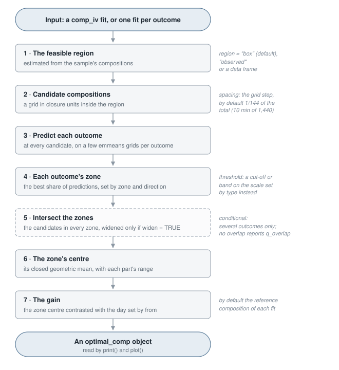

```{r setup, include = FALSE}
# R prints a note when two loaded packages register the same S3 method, as
# packages loaded with robCompositions do. The note is switched off here.
Sys.setenv("_R_S3_METHOD_REGISTRATION_NOTE_OVERWRITES_" = "false")
knitr::opts_chunk$set(
  collapse = TRUE,
  comment = "#>",
  fig.width = 7,
  fig.height = 5,
  out.width = "100%"
)
```

```{r load, message = FALSE}
library(timecoda)
```

`optimal_composition()` searches a fitted model for the compositions with the
best predicted outcome. The search has seven steps.

```{r pipeline, echo = FALSE, out.width = "82%", fig.alt = "Flowchart of the optimal_composition() pipeline: one comp_iv fit, or one fit per outcome, enters; the feasible region is estimated from the sample's compositions, as a per-part box by default, the observed compositions or a data frame; candidate compositions are placed on a grid in closure units inside the region, by default every 10 minutes of a 1,440-minute day; each outcome is predicted at every candidate on a few emmeans grids; each outcome's zone keeps the best share of its predictions, or those meeting a threshold; with several outcomes the zones are intersected, and widened only with widen = TRUE; each zone is summarized by its closed geometric mean and per-part range; and the prediction at the zone centre is contrasted with the reference day as the gain. The result is an optimal_comp object read by print() and plot()."}

```

# The question the search answers

A Goldilocks zone is the set of daily compositions with the best predicted
values of a health outcome, and the optimal composition is the centre of that
set. Dumuid et al. (2021) evaluated every composition on a 10-minute grid
inside a per-part box around the sample mean, kept the best 5% of the
predictions as each outcome's zone, and took the compositional centre of the
zones' overlap.

`optimal_composition()` searches the same kind of grid, and because the
candidates are fixed, a repeated search of the same fit returns the same
centre. The region and the grid are the same whatever the order of the parts.

# The example data and the two fits

The examples use the bundled `timeuse` data, described in
`vignette("composition-variable", package = "timecoda")`. Because the data are
simulated, the zones illustrate the computation and have no substantive
interpretation.

```{r declare}
cd <- declare_composition(
  data    = timeuse,
  parts   = c("MVPA", "LPA", "SB", "SPT"),
  closure = 1440,
  units   = "min/day",
  labels  = c(
    MVPA = "Moderate-to-vigorous PA",
    LPA  = "Light PA",
    SB   = "Sedentary behaviour",
    SPT  = "Sleep"
  )
)
```

A model whose linear predictor is linear in the isometric log-ratio (ILR)
coordinates has no interior optimum. To find a Goldilocks zone inside the
region, you need a fit that curves in the composition.

`fit_bmi` is a linear model of the body-mass-index z-score (`zbmi`) and
`fit_ob` a logistic regression of the obesity indicator (`obesity`), each
adjusted for sex. Both are fitted with `curvature = TRUE`, which writes the full
quadratic in the coordinates, so each equals the fit of the formula
`ilr()^2 + I(ilr()^2)` shown in
`vignette("advanced-models", package = "timecoda")`.

```{r fits}
fit_bmi <- comp_iv(comp = cd, outcome = "zbmi", model = "lm",
                   covariates = "sex", curvature = TRUE)
fit_ob  <- comp_iv(comp = cd, outcome = "obesity", model = "glm",
                   family = "binomial", covariates = "sex", curvature = TRUE)
```

# Part 1. One complete call

A lower z-BMI is the better outcome, so search `fit_bmi` with
`direction = "min"`. The other five arguments are written at the values a
default call uses for this 1,440-minute composition (i.e., the box of the mean
plus or minus 3 SD, on a 10-minute grid).

```{r complete}
opt <- optimal_composition(
  object    = fit_bmi,
  direction = "min",
  zone      = 0.95,
  region    = "box",
  sd        = 3,
  spacing   = 10,
  type      = "relative"
)
opt
```

The centre of a zone is the closed geometric mean of its compositions, and the
brackets give the smallest and largest value of each part among them. Under the
default `type = "relative"`, each candidate is valued by its mean difference in
z-BMI from the reference day (the `Scale` line), and the reference day is the
reference composition described in
`vignette("predicting-reallocations", package = "timecoda")`.

The gain is the contrast between the zone centre and the reference day,
averaged over sex as in the reference grid of `predict_realloc()`. At the
centre, the predicted z-BMI is 2.54 lower. The gain's confidence interval is
conditional on the centre, and the location of the zone has no interval of its
own (see `?optimal_composition`).

When more than half of the zone's compositions lie in the outer shell of the
region (i.e., with a part within one `spacing` of its limit), a further line
appears under the zone and states that the best composition may lie beyond the
edge of the region.

# Part 2. The arguments in turn

## The region

The search is confined to a feasible region, which you choose with `region`
(for the choices, see `?optimal_composition`). The default `"box"` limits each
part separately, on the closure scale, to its mean plus or minus `sd` standard
deviations (3 by default, as in Dumuid et al., 2021). Such a limit never extends
beyond the part's observed range in this package, and the limits cut to that
range are counted in the printed result.

To set the limits of the box by each part's quantiles in place of `sd`, use
`coverage`. Brakenridge et al. (2024) limited each part to its 1st and 99th
percentiles.

```{r region-box}
optimal_composition(object = fit_bmi, direction = "min",
                    coverage = c(0.01, 0.99))
```

To search the compositions of the sample, set `region = "observed"`. The 300
compositions of the sample are then the candidates in place of the grid, as in
Lund Rasmussen et al. (2023).

```{r region-observed}
optimal_composition(object = fit_bmi, direction = "min", region = "observed")
```

You can also give a data frame of compositions on the closure scale as the
region, with one column per part, and its rows are then the candidates.

## The candidates

On the grid, each of the first three parts is a positive multiple of `spacing`
minutes and the last part is the remainder. The default `spacing` is 1/144 of
the total, which is the 10 minutes of Dumuid et al. (2021) on a 1,440-minute
day. A search takes longer as the number of candidates grows, and the call stops
with an error when more than 1,000,000 lie inside the region. A coarser grid
holds fewer candidates and gives a similar centre.

```{r spacing}
optimal_composition(object = fit_bmi, direction = "min", spacing = 30)
```

With 30-minute steps, the centre has 119.0 minutes of moderate-to-vigorous
activity, against 125.2 with the default.

## The zone rule

A candidate enters an outcome's zone when its rank is at least `zone`, and you
set with `direction` whether a higher (`"max"`, the default) or a lower
(`"min"`) predicted outcome is better. The ranks are taken from the model's
linear predictor, so a zone ruled by `zone` is the same for both values of
`type`.

A zone can also be ruled by a value instead of a rank, as in the clinical
cut-offs of Vindiš et al. (2025). For `threshold`, you give one number for a
cut-off, met at or below it for `"min"`, or two numbers for a band, on the
`type` scale. Under the default `type = "relative"`, a threshold is an effect
versus `from`, which is a difference in z-BMI here and an odds ratio for the
logistic fit. A cut-off on the z-BMI itself therefore needs `type = "absolute"`.
With the cut-off at -0.5, the centre of the zone lies closer to the reference
day than the centre of Part 1.

```{r threshold}
optimal_composition(object = fit_bmi, direction = "min", type = "absolute",
                    threshold = list(zbmi = -0.5))
```

Lund Rasmussen et al. (2023) call a prediction healthy when it lies below the
85th percentile of all predictions. In this package, you write that rule as
`direction = "min", zone = 0.15`. A candidate's rank is the share of candidates
whose prediction is no better than its own, so with a rank of at least 0.15 the
85% of candidates with the lowest predictions are kept.

```{r zone-85}
optimal_composition(object = fit_bmi, direction = "min", zone = 0.15)
```

## Several outcomes

When `object` is a list of fits, one per outcome, every outcome is searched on
the same candidates, and you can give `direction` one value for all outcomes or
one per outcome.

```{r two-outcomes}
opt2 <- optimal_composition(object = list(zbmi = fit_bmi, obesity = fit_ob),
                            direction = "min")
opt2
```

The `Overall zone` is the intersection of the two outcomes' zones, as in Dumuid
et al. (2021), and Duncan et al. (2024) likewise kept the compositions in the
best band of all four of their outcomes. At the overall centre, where every gain
is now evaluated, the odds of obesity are 0.155 times those at the reference
day, and the 95% confidence interval includes 1.

Dumuid et al. (2021) widened the zones to the best 15% of the predictions when
the zones of the best 5% and 10% did not overlap. By default,
`optimal_composition()` keeps every zone at `zone`. When the zones share no
candidate, a message is printed, each outcome is evaluated at its own centre,
and the result holds `q_overlap` (the largest `zone` at which the zones would
share one).

```{r no-overlap}
optimal_composition(object = list(zbmi = fit_bmi, obesity = fit_ob),
                    direction = "min", zone = 0.999)
```

To widen the zones until they share a candidate, set `widen = TRUE`. Then
`zone` is lowered in steps of 0.05 for every outcome it rules, and never below
0.5 (the best 50%).

```{r widen}
optimal_composition(object = list(zbmi = fit_bmi, obesity = fit_ob),
                    direction = "min", zone = 0.999, widen = TRUE)
```

The step reached is stored as `zone_used`, and a `threshold` is never changed.
When a zone is widened far below `zone`, the compositions in it may not improve
every outcome over the reference day.

## A moderated fit

When the composition interacts with a covariate, the zone differs between the
covariate's values. If you add `moderator = "sex"` to the quadratic, the model
is `ilr()^2 + I(ilr()^2) + ilr() * sex`.

```{r moderated}
fit_mod <- comp_iv(comp = cd, outcome = "zbmi", model = "lm",
                   moderator = "sex", curvature = TRUE)
```

As in `predict_realloc()`, `by` defaults to a factor moderator that `at` does
not pin, so the search is split into one zone per level of the moderator, and
each level has its own region, estimated from its own rows, and its own
candidates.

```{r moderated-by}
optimal_composition(object = fit_mod, direction = "min")
```

If you pin the covariate at one value with `at` instead, the region is
estimated from every row.

```{r moderated-at}
optimal_composition(object = fit_mod, direction = "min",
                    at = list(sex = "female"))
```

## The day the gain is measured from

You can measure the gain from any day by giving `from` one positive value per
part, which is re-closed to the total. The example day is the one in
`vignette("predicting-reallocations", package = "timecoda")`.

```{r from}
optimal_composition(object = fit_bmi, direction = "min",
                    from = c(MVPA = 30, LPA = 240, SB = 660, SPT = 510))
```

The zone and its centre are unchanged, while the candidates' values and the
gain are now measured from the given day.

## Other engines

Under the default `type = "relative"`, each candidate is scored by its effect
versus `from`, the measure `predict_realloc()` reports. The search therefore
also runs on the engines without an absolute prediction, which are the Cox
(`"cox"`, `"coxme"`), ordinal (`"clm"`, `"clmm"`) and multinomial (`"mblogit"`)
fits. On a Cox fit, `direction = "max"` would favour the highest hazard. To
search for the lowest hazard of obesity onset, use `direction = "min"`.

```{r cox}
fit_cox <- comp_iv(comp = cd, time = "time", event = "event", model = "cox",
                   covariates = "sex", curvature = TRUE)
optimal_composition(object = list(onset = fit_cox), direction = "min")
```

On an ordinal fit, `direction = "max"` favours the higher outcome categories,
and a multinomial fit is searched for the outcome level named by `category`,
against the reference level (see `?optimal_composition`).

# Part 3. The zone on the surface

To see the zone on the surface of one outcome, use `plot()`. It draws ternary
panels, one for each group of three parts, as `plot.comp_iv()` does for a
surface, and the surface is on the `type` scale of the search, the effect
versus `from` under the default `type = "relative"`. With four parts, each panel
is a slice through the zone centre, which a red point marks, with the fourth
part held at its value there. The red outline is the convex hull of the slice's
computed cells that lie in the outcome's zone, as Duncan et al. (2024) outlined
their zones on ternary plots.

```{r plot-bmi, fig.alt = "One of four ternary panels, one for each group of three parts, of the quadratic linear model's mean difference in z-BMI from the reference day, a slice through the zone centre with the fourth part held at its value there. A smoothed patch of colour inside the search's box runs from dark purple for the lowest mean difference to yellow for the highest, a red outline encloses the computed cells in the z-BMI zone, and a red point marks the zone centre."}
plot(x = opt)
```

The surface is drawn only for the cells inside the search's region, and the rest
of the triangle is left blank.

On a search with several outcomes, you name the surface to draw with `outcome`.
The red point is then the overall centre, and the outline encloses that
outcome's own zone.

```{r plot-obesity, fig.alt = "One of four ternary panels of the logistic model's odds ratio of obesity versus the reference day, a slice through the overall zone centre with the fourth part held at its value there. A smoothed patch of colour runs from dark purple for the lowest odds ratio to yellow for the highest, a red outline encloses the computed cells in the obesity zone, and a red point marks the overall centre."}
plot(x = opt2, outcome = "obesity")
```

To draw the zone of one level of a search split with `by`, name the level with
`level`. The covariate is held at that level on the surface.

# Part 4. When the fit is linear

The predicted outcome of a fit with no curvature term in the coordinates is
linear in them, so its best prediction inside any region lies on the region's
edge, and the zone marks where the region ends. `optimal_composition()` still
runs the search.

In place of the outer-shell line, the printed result states two points under
each zone of such a fit, in every region: the fit has no interior optimum, so
the zone is the edge of the region in the direction of benefit, and
`curvature = TRUE` refits it with a surface that can hold one. The share of
the zone in the outer shell is still given in the `on_boundary` column of
`zones`.

Such a zone is located by the region, and it moves with a different `coverage`
or `region`. A linear fit therefore does not support a Goldilocks reading.

# References

Brakenridge, C. J., Koster, A., de Galan, B. E., Carver, A., Dumuid, D.,
Dzakpasu, F. Q. S., Eussen, S. J. P. M., Savelberg, H. H. C. M., Bosma, H.,
Owen, N., Schaper, N. C., Healy, G. N., & Dunstan, D. W. (2024). Associations
of 24 h time-use compositions of sitting, standing, physical activity and
sleeping with optimal cardiometabolic risk and glycaemic control: The
Maastricht Study. *Diabetologia*, 67(7), 1356-1367.

Dumuid, D., Wake, M., Burgner, D., Tremblay, M. S., Okely, A. D., Edwards, B.,
Dwyer, T., & Olds, T. (2021). Balancing time use for children's fitness and
adiposity: Evidence to inform 24-hour guidelines for sleep, sedentary time and
physical activity. *PLoS ONE*, 16(1), e0245501.

Duncan, M. J., Kuzik, N., Silva, D. A. S., Bélanger, R. E., Carson, V.,
Chaput, J.-P., Faulkner, G., Ferro, M. A., Turcotte-Tremblay, A.-M.,
Leatherdale, S. T., Patte, K. A., & Tremblay, M. S. (2024). "Goldilocks days"
for adolescent mental health: Movement behaviour combinations for well-being,
anxiety and depression by gender. *Mental Health and Physical Activity*, 26,
100572.

Lund Rasmussen, C., Gába, A., Stanford, T., Dygrýn, J., Dumuid, D., Janda, D.,
& Hron, K. (2023). The Goldilocks Day for healthy adiposity measures among
children and adolescents. *Frontiers in Public Health*, 11, 1158634.

Vindiš, J., Pelclová, J., Jašková, P., & Hron, K. (2025). The Goldilocks days
represent optimal time-use to prevent obesity, low physical performance, risk
and fear of falling in older adults. *Scientific Reports*, 15, 24729.

# See also

- `vignette("predicting-reallocations", package = "timecoda")`: reallocation
  estimates between named parts, their publication table and the reallocation
  figure.
- `vignette("advanced-models", package = "timecoda")`: the formula interface
  and `ilr()`, moderation and non-linear composition terms.
- `vignette("composition-predictor", package = "timecoda")`: fitting the models
  the search reads, and the fitted surface.
- `vignette("composition-variable", package = "timecoda")`: declaring and
  describing a composition in full.
- `vignette("timecoda", package = "timecoda")`: the whole workflow in one
  analysis.
