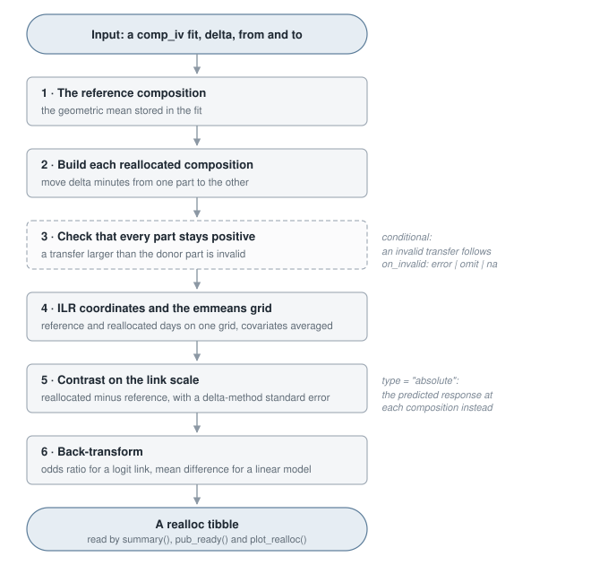

```{r setup, include = FALSE}
# R prints a note when two loaded packages register the same S3 method, as
# packages loaded with robCompositions do. The note is switched off here.
Sys.setenv("_R_S3_METHOD_REGISTRATION_NOTE_OVERWRITES_" = "false")
knitr::opts_chunk$set(
  collapse = TRUE,
  comment = "#>",
  fig.width = 7,
  fig.height = 5,
  out.width = "100%"
)
```

Pivot ILR slopes from `comp_iv()` are hard to interpret directly in minutes.
Compositional isotemporal substitution solves this by comparing two whole days:
a reference composition and the same day with `delta` minutes shifted from one
behaviour to another while holding the remaining behaviours fixed (Dumuid,
Stanford, Pedišić, et al., 2018; Dumuid et al., 2019; Dumuid et al., 2020).
Because these estimates come from observational regression models, they compare
expected outcomes across different compositions rather than causal within-person
changes.

We start by fitting a linear model for `zbmi` and a logistic model for
`obesity` on `timeuse`:

```{r fits, message = FALSE}
library(timecoda)

cd <- declare_composition(
  data    = timeuse,
  parts   = c("MVPA", "LPA", "SB", "SPT"),
  closure = 1440,
  labels  = c(
    MVPA = "Moderate-to-vigorous PA",
    LPA  = "Light PA",
    SB   = "Sedentary behaviour",
    SPT  = "Sleep"
  )
)

fit_bmi <- comp_iv(comp = cd, outcome = "zbmi", model = "lm")
fit_ob  <- comp_iv(comp = cd, outcome = "obesity", model = "glm",
                   family = "binomial")
```

## Pairwise reallocations

To estimate how obesity odds differ when 10, 20, or 30 minutes move from
sedentary behaviour (`from = "SB"`) to moderate-to-vigorous activity
(`to = "MVPA"`), pass the fit to `predict_realloc()`:

```{r complete}
r <- predict_realloc(
  object = fit_ob,
  from   = "SB",
  to     = "MVPA",
  delta  = c(10, 20, 30)
)
summary(object = r)
```

Moving 10 minutes from `SB` to `MVPA` is associated with roughly 18% lower odds
of obesity (OR = 0.822) relative to the reference day, and each additional 10
minutes brings a smaller multiplicative drop because the model operates on
log-ratios. Note that per-row p-values are unadjusted for multiple testing.

By default, every reallocation is anchored at the sample's closed geometric
mean, which is printed with the fit:

```{r print-fit}
print(x = fit_ob)
```

Here, the reference day contains only 28.1 minutes of `MVPA`, which sets an
upper bound on how many minutes can be taken out of `MVPA`. Behind the scenes,
`predict_realloc()` builds each reallocated day, transforms both compositions
into the fit's ILR basis on an `emmeans` reference grid, and contrasts them on
the link scale before back-transforming:

```{r pipeline, echo = FALSE, out.width = "82%", fig.alt = "Flowchart of the predict_realloc() pipeline: take the reference composition stored in the fit, build each reallocated composition by moving delta minutes from one part to another, check that every part stays positive with an invalid transfer handled by on_invalid, express every composition in ILR coordinates on an emmeans reference grid with covariates averaged, contrast each reallocated composition against the reference on the link scale or, when type is absolute, predict the response at each composition, back-transform to the model's effect measure, and return a realloc tibble read by summary(), pub_ready() and plot_realloc()."}

```

## Asymmetry, reversals, and invalid transfers

Reversing the transfer—moving time out of `MVPA` into `SB`—shows the classic
asymmetry of compositional substitution (Dumuid, Stanford, Pedišić, et al.,
2018; Dumuid et al., 2020):

```{r reverse}
predict_realloc(object = fit_ob, from = "MVPA", to = "SB", delta = c(10, 20, 30))
```

Moving 10 minutes out of `MVPA` gives an odds ratio of 1.32—larger than the
reciprocal of 0.822 ($\approx 1.22$)—because subtracting 10 minutes from 28.1
is a much larger relative change than adding 10. (Passing negative values to
`delta` with the original `from` and `to` produces the same reversed
estimates.)

In that table, the 30-minute row returns `NA` because subtracting 30 minutes
from 28.1 drives `MVPA` below zero. By default (`on_invalid = "na"`), invalid
transfers stay in the output as missing rows so multi-step sweeps do not fail
midway. You can drop them instead with `on_invalid = "omit"`, or halt
immediately with `on_invalid = "error"`:

```{r invalid-omit}
predict_realloc(object = fit_ob, from = "MVPA", to = "SB", delta = c(15, 60),
                on_invalid = "omit")
```

Transfers that leave a part strictly positive but very close to zero pass this
check, though predicted outcomes grow rapidly near the simplex boundary
(Dumuid et al., 2020).

## Reallocation schemes

When you omit both `from` and `to`, `predict_realloc()` evaluates all
$D(D - 1)$ ordered pairs at once:

```{r all-pairs}
predict_realloc(object = fit_ob, delta = 15)
```

In these data, the six transfers involving `MVPA` produce the largest shifts in
odds ratios.

To move time between one focal behaviour and all remaining behaviours in
proportion to their reference values—preserving the ratios among the remaining
parts—use `scheme = "one-to-all"`:

```{r one-to-all}
r_rest <- predict_realloc(object = fit_ob, to = "MVPA", delta = c(10, 20, 30),
                          scheme = "one-to-all")
summary(object = r_rest)
```

To reverse the direction so the focal behaviour gives time to the rest, swap
`to` for `from = "MVPA"`; omitting both cycles through every behaviour as the
focal receiver.

For scenarios that shift time across three or more behaviours simultaneously,
supply a named zero-sum vector (or list of vectors) to `realloc` instead of
`from`, `to`, or `scheme`:

```{r custom}
r_custom <- predict_realloc(object = fit_ob,
                            realloc = c(SPT = 30, SB = -15, LPA = -15))
summary(object = r_custom)
```

## Relative contrasts vs. absolute predictions

By default (`type = "relative"`), `predict_realloc()` returns the contrast
between the reallocated day and the reference day—a mean difference for linear
models and an odds ratio for logistic models:

```{r bmi-relative}
predict_realloc(object = fit_bmi, from = "SB", to = "MVPA", delta = c(10, 20, 30))
```

Moving 10 minutes from `SB` to `MVPA` is associated with a 0.209-unit lower
mean `zbmi`. To inspect predicted outcomes at each composition directly, switch
to `type = "absolute"`:

```{r bmi-absolute}
predict_realloc(object = fit_bmi, from = "SB", to = "MVPA",
                delta = c(10, 20, 30), type = "absolute")
```

The `delta = 0` row gives the predicted outcome at the reference day;
subtracting it from any subsequent row recovers the relative mean difference.
On the logistic model, `type = "absolute"` returns predicted obesity
probabilities whose odds ratios match the relative estimates above:

```{r ob-absolute}
predict_realloc(object = fit_ob, from = "SB", to = "MVPA",
                delta = c(10, 20, 30), type = "absolute")
```

## Visualizing reallocation curves

To plot pairwise reallocations as continuous curves across all behaviour pairs,
use `plot_realloc()`. Each panel in the lower-triangular grid sweeps one pair
in both directions up to `delta_max` minutes (the colour of each side of a
curve marks the behaviour gaining time). Here we use `n_points = 20` for
speed; the default of 41 draws smoother curves:

```{r plot, fig.width = 8, fig.height = 7, fig.alt = "Lower-triangular grid of six panels, one per pair of parts, each showing the odds ratio of obesity against the minutes reallocated between the two parts in either direction, with a confidence ribbon, a dashed line at 1, and colour marking the part gaining time."}
p <- plot_realloc(object = fit_ob, delta_max = 60, n_points = 20)
```

In the `MVPA` panels, the curves stop at 24 minutes on the side where `MVPA`
loses time—the largest evaluated step that keeps `MVPA` positive from its
28.1-minute reference—and rise more steeply than they fall on the opposite
side.

The returned object stores both the assembled `figure` and individual `panels`,
so you can pull out a single comparison on its own:

```{r plot-panel, fig.width = 6, fig.height = 4, fig.alt = "A single reallocation panel for obesity: the odds ratio against the minutes reallocated between sedentary behaviour and moderate-to-vigorous activity, with a confidence ribbon and a dashed line at 1."}
p$panels[["MVPA.SB"]]
```

To omit a behaviour's panels from the grid without removing it from the
underlying composition, pass its name to `exclude` (with
`scheme = "one-to-all"`, excluded parts still participate in the reallocation):

```{r plot-exclude, fig.width = 8, fig.height = 5, fig.alt = "Reallocation figure for obesity without the moderate-to-vigorous activity panels: three panels showing the odds ratio against the minutes reallocated between light activity, sedentary behaviour and sleep, with confidence ribbons and a dashed line at 1."}
plot_realloc(object = fit_ob, delta_max = 60, n_points = 20, exclude = "MVPA")
```

For a linear model like `fit_bmi`, the vertical axis switches automatically to
mean differences with a dashed reference line at 0:

```{r plot-bmi, fig.width = 8, fig.height = 7, fig.alt = "Reallocation figure for the linear model: six panels showing the mean difference in z-BMI against the minutes reallocated between each pair of parts, with a confidence ribbon and a dashed reference line at 0."}
plot_realloc(object = fit_bmi, delta_max = 60, n_points = 20)
```

## Custom reference days and subgroup moderation

To anchor reallocations at a specific policy or guideline day rather than the
sample geometric mean, pass a positive vector summing to the composition total
to `reference`:

```{r reference}
predict_realloc(object = fit_ob, from = "SB", to = "MVPA",
                delta = c(10, 20, 30),
                reference = c(MVPA = 30, LPA = 240, SB = 660, SPT = 510))
```

Starting from 30 minutes of `MVPA` instead of 28.1 shifts the 10-minute odds
ratio slightly from 0.822 to 0.830, because the same transfer represents a
smaller relative increase (Dumuid, Stanford, Pedišić, et al., 2018).

Because all predictions for linear and full quadratic models are invariant to
the choice of ILR basis (only non-invariant specifications like squares-only
`I(ilr()^2)` or `poly()` depend on part order; see `?ilr`), `predict_realloc()`
evaluates every contrast in the single basis stored in the fit. When a model
includes main-effect covariates only, they cancel out of relative contrasts and
are averaged over on the `emmeans` grid for absolute predictions. When the
composition interacts with a covariate—for example via `moderator = "sex"` (see
`vignette("advanced-models", package = "timecoda")`)—estimates depend on the
covariate value, so you either split by subgroup with `by` or pin a value with
`at` (e.g., `at = list(sex = "female")`). For a factor `moderator`, `by`
defaults to that moderator automatically:

```{r covariates-by}
fit_sex <- comp_iv(comp = cd, outcome = "obesity", model = "glm",
                   family = "binomial", moderator = "sex")
r_sex <- predict_realloc(object = fit_sex, from = "SB", to = "MVPA",
                         delta = c(10, 20, 30), by = "sex")
summary(object = r_sex)
```

To compare curves visually across sexes, `plot_realloc()` also accepts `by` and
stacks one panel grid per level on a shared vertical axis:

```{r covariates-plot, fig.width = 8, fig.height = 11, fig.alt = "Grouped reallocation figure for obesity with sex as moderator: two lower-triangular grids of six panels stacked as rows, the first titled sex: female and the second sex: male, each panel showing the odds ratio against the minutes reallocated between a pair of parts with a confidence ribbon and a dashed line at 1, on one vertical axis shared by both grids."}
plot_realloc(object = fit_sex, delta_max = 60, n_points = 20, by = "sex")
```

## Publication tables

To build a formatted `gt` table across all pairs and magnitudes, pass the
reallocation summary to `pub_ready()`:

```{r all-pairs-sweep}
r_all <- predict_realloc(object = fit_ob, delta = c(10, 20, 30))
```

```{r pub-ready, eval = requireNamespace("gt", quietly = TRUE)}
pub_ready(x = summary(object = r_all), digits = 2)$effects
```

Dashes in the 30-minute column mark the three invalid transfers out of `MVPA`.
By default, estimates with $p < 0.05$ are flagged with an asterisk; you can
tighten that threshold with `p_flag`:

```{r pub-ready-flag, eval = requireNamespace("gt", quietly = TRUE)}
pub_ready(x = summary(object = r_all), digits = 2, p_flag = 1e-6)$effects
```

## References

Dumuid, D., Pedišić, Ž., Palarea-Albaladejo, J., Martín-Fernández, J. A.,
Hron, K., & Olds, T. (2020). Compositional data analysis in time-use
epidemiology: What, why, how. *International Journal of Environmental Research
and Public Health*, 17, 2220.

Dumuid, D., Pedišić, Ž., Stanford, T. E., Martín-Fernández, J. A., Hron, K.,
Maher, C. A., Lewis, L. K., & Olds, T. (2019). The compositional isotemporal
substitution model: A method for estimating changes in a health outcome for
reallocation of time between sleep, physical activity and sedentary
behaviour. *Statistical Methods in Medical Research*, 28, 846-857.

Dumuid, D., Stanford, T. E., Pedišić, Ž., Maher, C., Lewis, L. K.,
Martín-Fernández, J. A., Katzmarzyk, P. T., Chaput, J. P., Fogelholm, M.,
Standage, M., Tremblay, M. S., & Olds, T. (2018). Adiposity and the
isotemporal substitution of physical activity, sedentary time and sleep among
school-aged children: A compositional data analysis approach. *BMC Public
Health*, 18, 311.

## See also

- `vignette("composition-predictor", package = "timecoda")`: fitting the models
  whose reallocations this vignette estimates.
- `vignette("optimal-composition", package = "timecoda")`: searching a fitted
  model for the Goldilocks zone.
- `vignette("timecoda", package = "timecoda")`: the complete workflow, from
  declaring a composition to the reallocation figure.
