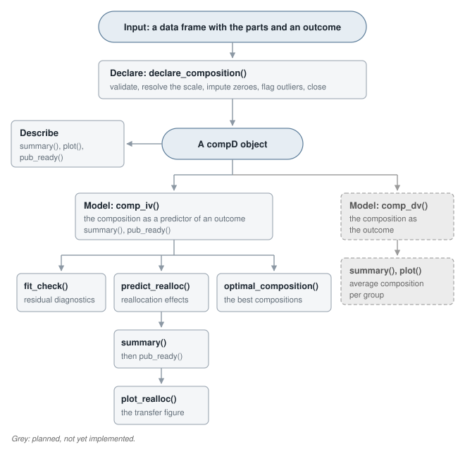

```{r setup, include = FALSE}
# R prints a note when two loaded packages register the same S3 method, as
# packages loaded with robCompositions do. The note is switched off here.
Sys.setenv("_R_S3_METHOD_REGISTRATION_NOTE_OVERWRITES_" = "false")
knitr::opts_chunk$set(
  collapse = TRUE,
  comment = "#>",
  fig.width = 7,
  fig.height = 5,
  out.width = "100%"
)
```

`timecoda` supports time-use compositional data analysis (CoDA) from data
declaration through regression modelling, isotemporal time reallocations, and
optimal-composition search. We assume basic familiarity with R regression
workflows and core CoDA concepts (simplex closure, isometric log-ratio
transformations, and pivot coordinates).

```{r load, message = FALSE}
library(timecoda)
```

Every analysis follows a single pipeline built around two objects: `compD` (a
validated, closed composition) and `comp_iv` (a regression model with the
composition as predictor).

```{r workflow, echo = FALSE, out.width = "82%", fig.alt = "Flowchart of the timecoda workflow. A data frame with the parts and an outcome enters declare_composition(), which returns a compD object. The compD is described with summary(), plot() and pub_ready(), and modelled as a predictor of an outcome with comp_iv(). A comp_iv() fit leads to fit_check() for diagnostics, to predict_realloc() for reallocation estimates, which are summarized with summary() and pub_ready() and drawn with plot_realloc(), and to optimal_composition() for a search of the fit for the best compositions. A second path, drawn in grey and dashed, would model the composition as the outcome with comp_dv(), described with summary() and plot(). A caption at the bottom explains that grey marks what is planned and not yet implemented."}

```

*(Modelling the composition as the outcome via `comp_dv()` is planned for a
future release.)*

## Declaring and describing a composition

We will use the bundled `timeuse` dataset, a simulated sample of 300
participants whose 1,440-minute days are partitioned into moderate-to-vigorous
physical activity (`MVPA`), light physical activity (`LPA`), sedentary
behaviour (`SB`), and sleep period time (`SPT`), alongside BMI z-score (`zbmi`)
and binary obesity status (`obesity`).

```{r data}
parts <- c("MVPA", "LPA", "SB", "SPT")
head(timeuse[c(parts, "zbmi", "obesity")])
```

To prepare these columns for analysis, we declare the composition once with
`declare_composition()`. It validates the parts, imputes any zeroes, closes
rows to 1,440 minutes, and stores the metadata so downstream functions reuse
the same labels and scale:

```{r declare}
cd <- declare_composition(
  data    = timeuse,
  parts   = c("MVPA", "LPA", "SB", "SPT"),
  closure = 1440,
  labels  = c(
    MVPA = "Moderate-to-vigorous PA",
    LPA  = "Light PA",
    SB   = "Sedentary behaviour",
    SPT  = "Sleep"
  )
)

summary(object = cd)
```

In the descriptive table, `geom_mean` gives the closed compositional centre
summing to 1,440 minutes, while the remaining columns summarize the raw data.
To format the summary for a manuscript with `gt`, pass it to `pub_ready()`:

```{r pub-ready-cd, eval = requireNamespace("gt", quietly = TRUE)}
pub_ready(x = summary(object = cd), digits = 1)$desc
```

We can inspect the marginal distributions, pairwise ternary projections (with
the compositional centre and 95% confidence region), and variation matrix
together using `plot()`:

```{r plot-cd, fig.width = 10, fig.height = 7, fig.alt = "Density curves and boxplots of the four parts in minutes per day; four ternary plots, one for each set of three parts, each with the geometric mean marked by dashed crosshairs and a 95% confidence region drawn as a closed curve; and a heatmap of the variation matrix between the four parts."}
plot(x = cd)
```

For zero imputation, multivariate outlier screening, and varying-total
closures, see `vignette("composition-variable", package = "timecoda")`.

## Modelling an outcome from the composition

With `cd` declared, we can test whether daily time use is associated with
obesity. Here we fit a logistic regression with `comp_iv()`, which handles the
pivot ILR transformation behind the scenes (linear, multilevel, survival,
ordinal, and robust engines use the same interface; see
`vignette("advanced-models", package = "timecoda")`):

```{r fit}
fit_ob <- comp_iv(comp = cd, outcome = "obesity", model = "glm",
                  family = "binomial")
fit_ob
```

Printing the fit shows the underlying model call in the initial pivot basis.
The summary runs an order-invariant omnibus Wald test across all coordinates
and rotates the pivot basis $D$ times so each part appears first against the
remaining $D - 1$ parts:

```{r summary-fit}
summary(object = fit_ob)
```

An odds ratio below 1, as for `MVPA`, means that a day with more `MVPA`
relative to the rest of the day is associated with lower odds of obesity.
Because a one-unit change in a log-ratio coordinate has no direct reading in
minutes, we use reallocation estimates next to express the same model on the
minute scale. See `vignette("composition-predictor", package = "timecoda")` for
full model interpretation and response surfaces.

## Checking the fit

Before interpreting predictions, we check residual diagnostics with
`fit_check()`, which uses simulated quantile residuals from `DHARMa` for linear
and generalized linear models:

```{r fit-check, eval = requireNamespace("DHARMa", quietly = TRUE), fig.show = "hide", fig.alt = "DHARMa residual diagnostic plots for the logistic model."}
fit_check(object = fit_ob)
```

None of the diagnostic checks flags a lack of fit.

## Estimating time reallocations

To express the logistic model in minutes, we use compositional isotemporal
substitution via `predict_realloc()`. By default, reallocations start from the
sample's closed geometric mean and return relative contrasts on the model's
effect scale (here, an odds ratio). Moving 15 minutes from sedentary behaviour
to moderate-to-vigorous activity, holding sleep and light activity constant, is
associated with lower odds of obesity:

```{r realloc}
predict_realloc(object = fit_ob, from = "SB", to = "MVPA", delta = 15)
```

To see the predicted probability of obesity at both compositions instead of the
odds ratio, switch to `type = "absolute"`:

```{r realloc-absolute}
predict_realloc(object = fit_ob, from = "SB", to = "MVPA", delta = 15,
                type = "absolute")
```

You can also evaluate several reallocation magnitudes in one call by passing a
vector to `delta`, then format the sweep with `pub_ready()`:

```{r realloc-sweep}
r <- predict_realloc(object = fit_ob, from = "SB", to = "MVPA",
                     delta = c(10, 20, 30))
summary(object = r)
```

```{r pub-ready-realloc, eval = requireNamespace("gt", quietly = TRUE)}
pub_ready(x = summary(object = r), digits = 2)$effects
```

To visualize reallocation curves across every pair of behaviours up to 60
minutes, pass the fit to `plot_realloc()`:

```{r realloc-plot, fig.height = 6, fig.alt = "Reallocation plot in a lower-triangular grid of six panels, one per pair of parts, each showing the odds ratio of obesity with its confidence ribbon against the minutes reallocated between the two parts, and a dashed reference line at an odds ratio of 1."}
plot_realloc(object = fit_ob, delta_max = 60)
```

See `vignette("predicting-reallocations", package = "timecoda")` for asymmetric
reversals, one-to-all schemes, custom reference compositions, and subgroup
moderation.

## Finding the optimal composition

To identify daily compositions with the best predicted outcome (the Goldilocks
zone), we search a feasible grid inside the empirical sample range with
`optimal_composition()`. Because `fit_ob` is linear in ILR coordinates,
predictions keep improving in one direction and the zone lands on the edge of
the feasible region; refitting with `curvature = TRUE` allows an interior
optimum (see `vignette("optimal-composition", package = "timecoda")`).

```{r optimal}
opt <- optimal_composition(object = fit_ob, direction = "min")
opt
```

```{r optimal-plot, fig.width = 10, fig.height = 7, fig.alt = "Four ternary plots of the search, one for each set of three parts with the fourth part held at the zone centre. Inside the searched region, tiles are coloured by the odds ratio of obesity against the reference day, a red outline surrounds the zone and a red point marks its centre."}
plot(x = opt)
```

In each ternary panel, the fourth behaviour is held at the zone centre (red
point), and the red outline marks the zone boundary.

## See also

- `vignette("composition-variable", package = "timecoda")`: validating data,
  imputing zeroes, flagging multivariate outliers, and descriptive plots.
- `vignette("composition-predictor", package = "timecoda")`: modelling an
  outcome from a composition and checking the fit.
- `vignette("predicting-reallocations", package = "timecoda")`: reallocation
  estimates, publication tables, and transfer curves.
- `vignette("optimal-composition", package = "timecoda")`: single- and
  multi-outcome Goldilocks-zone optimization.
- `vignette("advanced-models", package = "timecoda")`: multilevel, survival,
  ordinal, robust, and formula-based models.
- Check each function's help page for full argument lists and runnable
  examples.
